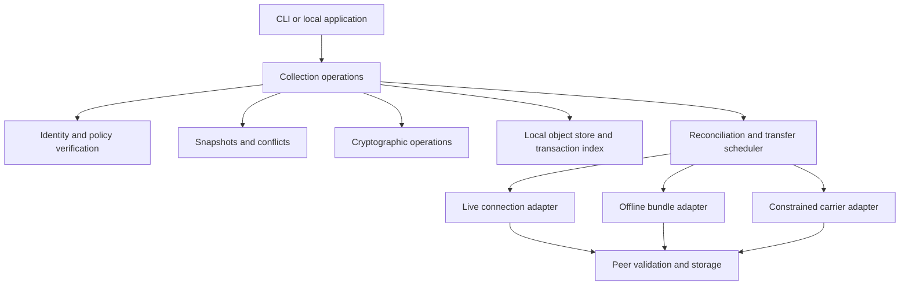

# Arc design review draft

Status: proposed architecture, revision 0.1, 2026-10-16. This is a design deliverable, not implementation approval, a frozen interoperable protocol, or a security assurance. There is no new executable implementation. The implementation gate is closed until the decisions and specification work in [the decision register](docs/decisions-and-sources.md) are resolved and the user approves the design.

## 1. Purpose and requirements

Arc is decentralized encrypted storage with verifiable synchronization independent of the medium carrying the data. An object can move through a local network, the internet, removable media, Bluetooth, SMS or radio without changing its identity or the rules for accepting it. A node can operate alone, exchange with a peer, or use optional storage and relay nodes. Durable storage and sync are core responsibilities from the beginning.

The user-established requirements are secure decentralized data storage, source/transport independence, verifiable exchange between nodes, a ground-up redesign, and a full design before implementation. The preserved prototype's thesis is relevant; its security, anonymity, recovery and scale claims are not inherited. Luma is an independent possible consumer, not a core dependency or a reason to narrow Arc into a research archive. No AI model is part of authorization, encryption or verification.

The remaining choices in this document are recommendations for review. In particular, private collections, a single logical membership authority, snapshot-based history, Rust, the CLI-first experience and release sequencing are proposed defaults, not requirements the user has already approved.

### Intended first user and scenario

Start with a person or small invited group preserving and exchanging arbitrary files across devices they control, with optional ciphertext copies on someone else's device. The initial interaction is deliberate capture and restore, not a transparent filesystem or an automatic two-way folder mirror. A CLI and structured local API establish the behavior that later desktop/mobile interfaces must preserve.

Example: a laptop captures a collection while offline. A second device receives some objects over a local connection. A third device carries the rest on a drive. The destination validates the combined result, identifies the exact version it can restore, and reports missing history or competing versions without claiming global freshness. The courier need not have decryption keys.

### Required properties

| ID | Requirement | Design responsibility |
| --- | --- | --- |
| R1 | No mandatory central server, account service or online authority for ordinary reads/writes/exchange | Local state, pinned identities, offline policy records |
| R2 | Equal end-to-end acceptance rules across carriers | Immutable object format and one validation engine |
| R3 | Unauthorized carriers/storage cannot read content | Content encryption before export; separate key envelopes |
| R4 | Detect substitution, corruption and unauthorized writes | Content digests, signatures, policy verification and AEAD |
| R5 | Preserve independent offline work | Snapshot DAG, explicit concurrent heads, reviewed merge |
| R6 | Resume interrupted and mixed-medium transfers | Bounded objects, idempotent intake, persistent transfer state |
| R7 | Report preservation and synchronization precisely | Named roots, scope-specific completeness, local durability and dated peer receipts |
| R8 | Recover without a provider | Open export format, user-held keys/recovery kit and recovery exercise |
| R9 | Preserve data when trust or interpretation fails | Quarantine, retained pending writes, safe restore and no automatic destructive pruning |
| R10 | Bound hostile input and resource consumption | Admission quotas, parser limits, backpressure and explicit budgets |

### Non-goals for the first protocol profile

Public permissionless discovery, anonymous presence, hidden traffic relationships, global consensus, blockchain, cryptocurrency, guaranteed delivery, provable remote erasure, regulatory certification, threshold key recovery, erasure coding, a custom radio stack, collaborative text editing, mobile UI, filesystem mounting and automatic background synchronization are outside the first profile. These are explicit scope limits, not obstacles to later profiles.

An SMS carrier or internet relay may itself be centralized. Arc's independence means no particular carrier owns the collection or becomes necessary to verify it. Servers are permitted, optional participants. Transport independence does not promise identical bandwidth, cost or latency across media.

## 2. Architecture

The adapter boundary is below authorization and immutable object identity. Adapters deliver bytes and report capabilities; they cannot authorize membership, change signatures, choose current versions, receive content keys by default or bypass intake checks. Local capture must pass the same content/format validation as remote intake before publishing a snapshot.

### Logical modules and ownership

These are responsibility boundaries, not a mandate to create this many Rust crates before the first implementation review.

| Module | Owns | Must not own |
| --- | --- | --- |
| Format | Canonical types, format/profile versions, bounds, identifiers | Filesystem, network or key access |
| Cryptography | Reviewed suite calls, keys, wrapping, domain separation | User intent, membership decisions or transport selection |
| Authority | Pinned root, policy chain, permissions, epoch fences, fork detection | Automatic trust of discovered peers |
| Collections | Capture, snapshot/manifest graph, conflict and merge semantics | Undeclared deletion or clock-based winner selection |
| Storage | Atomic immutable objects, durable journals, rebuildable index, pins and quarantine | Plaintext export or peer availability claims |
| Replication | Selected roots, missing-object reconciliation, scheduling and acknowledgments | Weakening validation for a particular carrier |
| Adapters | File/bundle I/O or a specific connection/fragmentation mapping | Authorizing, decrypting or executing received content |
| Local interface | Intent, previews, progress, explicit decisions and machine-readable results | Passing secrets through ordinary logs or remote AI services |

Start with one Rust workspace only after approval. Choose maintained libraries for cryptography, CBOR, persistence and live-session security through the dependency gate. No fork or library is selected solely because it appeared in the market research.

## 3. Collections, devices and topology

A collection is the unit of identity, membership, encryption epochs, version history and retention policy. Its random identifier is bound to an initially pinned root verification key. Names are human labels; matching names never establish continuity or trust.

A device has independent signing, key-envelope recipient and live-session key roles. The final profile must say whether these are three independent key pairs; the recommendation is to keep them separate and bind them in a signed device record rather than convert/reuse key material across protocols. A restored/replacement device receives a new identity unless an explicit recovery procedure establishes why reusing an old key is safe.

The membership authority signs a linear sequence of policies. It can be an offline key held by the owner. Ordinary devices do not need to contact it to capture, restore or exchange authorized data. This deliberately centralizes membership decisions for each private collection while decentralizing storage, ordinary writes and delivery. Multi-admin consensus and authority succession are separate future designs.

Permissions are separate concepts: read content, publish snapshots, admit/store ciphertext, and change policy. The first interface offers reader, writer (read plus publish), and ciphertext-storage roles. Blind write-only submission is deferred because producing a complete snapshot requires understanding its manifest. Policy administration does not itself grant decryption; the owner must separately possess the relevant content keys to perform data recovery.

The collection is the first profile's read-permission boundary. Selectively transferring a directory or snapshot saves storage/bandwidth; it does not create narrower authorization for a reader who holds the collection's epoch keys. Use separate collections for genuinely different reader groups. Collection-scoped public graph metadata is visible to admitted storage nodes; metadata privacy limits are explicit in [security](docs/security.md).

### Topologies

- One device plus exported backup: local capture, verification and recovery without discovery or network services.
- Several reader/writer devices: independent offline snapshots, opportunistic exchange and explicit conflict resolution.
- Blind storage node: retains accepted ciphertext and public verification metadata under its own quota/retention contract.
- Physical courier: transports an opaque file/package without running Arc or trusting its contents.
- Network relay: forwards bounded admitted material without content keys; delivery and retention are separate operations.

A device can have several roles in different collections. An untrusted USB drive is a carrier, not automatically a member. Public discovery, automatic peer admission and unrestricted relaying are disabled in the first profile.

## 4. User-visible behavior

### Create and enroll

Create a collection and device identity, name a storage location, choose local retention and create a recovery kit. Show the root fingerprint and recovery limitations. Before storing the only copy of valuable material, run a restore exercise with disposable data. An invitation binds the expected collection/root, recipient keys, policy checkpoint and assigned rights; accepting it requires authenticated fingerprint verification. Merely importing a package must never enroll a collection or replace a root.

### Capture

Select a directory or logical file collection and preview what will be captured or excluded. Capture regular files and directories, preserving exact bytes. Do not follow symlinks, execute files, ingest device nodes or silently normalize unsupported names. A file modified during capture causes that capture to fail or request a retry; do not publish a mixed file as an exact snapshot. Create encrypted chunks and manifests, then publish the signed snapshot only after its local object closure is durable.

Capture is point-in-time only to the strength of the filesystem snapshot or change-detection mechanism actually used. Reading ordinary files sequentially cannot promise an application-consistent snapshot of a running database. The local interface must state that limit.

### Exchange

Select a collection and a named snapshot, frontier or retained scope. Preview destination identity, selected roots, key envelopes being sent, estimated bytes and any carrier cost. Use a live connection or export a package. Receiving data imports it into bounded staging and validates it; it does not restore files over the user's working directory. Repeated deliveries converge on the same immutable objects.

For low-capacity media, display why a transfer is waiting or too large. Never silently purchase SMS messages, change networks, turn on radios, start services or broaden a selected scope. Background operation will need its own explicit configuration after the foreground behavior works.

### Inspect and resolve

Show local heads, policy checkpoint, accepted/quarantined versions, selected snapshot completeness, missing objects, key availability, known peer receipts and locally protected roots. Use wording such as “snapshot S is complete locally; history incomplete; policy verified through P” rather than a universal “synced” badge.

When two writers diverge, retain both complete logical states. The user can inspect changes, restore either, or produce a merge snapshot naming every head it resolves. Choosing one side is still an explicit merge decision. A merge must not erase the inputs from retained history. Deleting a file in one branch and editing it in another remains a conflict.

### Restore and recover

Restore a chosen exact snapshot into a new destination by default. Validate authorization separately from ciphertext integrity, then decrypt/authenticate, validate manifest structure and write through a staging directory. Refuse traversal, unsafe links, naming collisions and overwrites without an explicit reviewed mapping. Do not execute restored content. Report per-file failures and whether an atomic whole-directory promotion was supported by the target filesystem.

Recovery uses retained ciphertext plus the appropriate keys; either alone is insufficient. A stale recovery kit must not silently become the current policy authority. See [operations](docs/operations-and-validation.md) for crash, key-loss, corruption and recovery procedures.

## 5. Major design choices

**Complete snapshots with shared encrypted objects.** Every snapshot describes a complete logical tree, while unchanged ciphertext can be reused within the collection and epoch. This avoids reconstructing file contents by replaying an unbounded operation log. Historical parent descriptors are still needed to establish ancestry and accepted-head status. Snapshot materialization and history completeness are separate properties.

**Explicit concurrent heads.** There is no clock-based last-writer-wins rule and no automatic merge of arbitrary data. Nodes with the same validated records and policy checkpoint should derive the same eligible head set. An offline node cannot know about unseen changes elsewhere.

**Content security independent of carrier.** Encryption precedes transport. A new encrypted connection is useful additional protection, but it does not replace signed records, content verification or encrypted storage. A courier can carry bytes without being a reader.

**Two exchange modes.** Interactive reconciliation minimizes redundant data when a return connection exists. Offline packages declare their contents and completeness scope without requiring negotiation. They feed the same validator and object store.

**Bounded first deployment.** Full replicas and selected snapshot copies precede erasure coding. Initial runnable adapters would be file packages, one explicit live IP connection and a deterministic constrained-link test adapter. Real Bluetooth, radio and SMS adapters remain intended extensions with individual profiles and hardware/provider validation; a simulator is not evidence those integrations work.

**Conservative revocation.** A policy transition commits a fixed accepted frontier from the preceding epoch. Once learned, that boundary determines which old writes remain accepted, regardless of delivery order. Late writes are preserved in quarantine for reviewed reissue. New content uses fresh keys; past disclosed plaintext cannot be recalled.

## 6. Design documents and approval boundary

- [Data, versions and exchange](docs/data-and-sync.md): record model, completeness, conflict/revocation interaction, reconciliation, packages, adapter contracts and finite limits.
- [Security and key lifecycle](docs/security.md): adversaries, permissions, candidate cryptographic profile, enrollment, recovery, rotation and metadata disclosure.
- [Operations and validation](docs/operations-and-validation.md): persistence, safe restore, retention, interfaces, acceptance scenarios and gated delivery plan.
- [Decisions and research](docs/decisions-and-sources.md): recommended defaults, alternatives, source evidence and the concrete work still required before implementation approval.

This document set is the full architecture review draft. Wire schemas, exact cryptographic preimages and key-file formats, reviewed dependency versions, and independent cryptographic assessment are explicit pre-implementation gates. A design draft can be complete enough to review its architecture without being a frozen security protocol. Do not begin implementation merely because a phase or command appears here.
